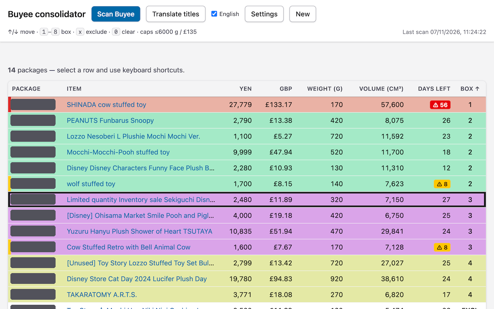

# Buyee Consolidator



Chrome extension (Manifest V3) that reads your packages from the Buyee "My Luggage" page and helps you plan which ones to consolidate into the same box, within value and weight limits.

- **Scan Buyee** reads packages from an open `buyee.jp` tab (clicking "load more" as needed). Re-scans merge in: new packages are unassigned, packages that disappeared are shown greyed out and crossed over.
- Assign boxes by keyboard (`1`–`8`, `x` to exclude, `0` to clear) or with **Auto-assign**.
- Hover an item for a picture; **Translate titles** uses Chrome's on-device Japanese→English Translator API.
- Value/weight limits and the JPY→GBP rate are editable under **Settings**.
- Everything is stored locally in `chrome.storage.local`; nothing is sent to any server.

Not affiliated with Buyee.

## Build

```
npm install
npm run build
```

Then open `chrome://extensions`, enable Developer mode, **Load unpacked**, and select `dist/`.
